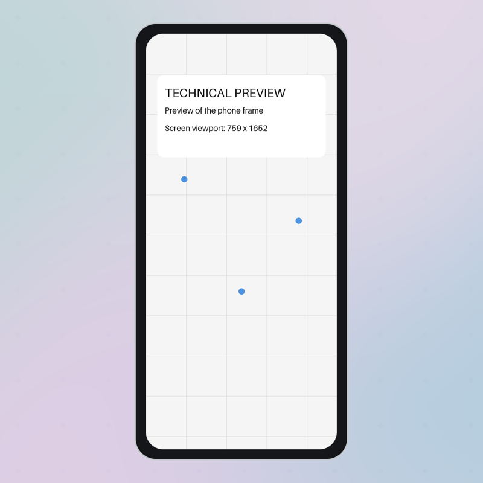

# Showtime

Showtime записывает действие в iOS Simulator и собирает из него короткое продуктовое видео. На выходе — квадратный MP4 размером 1920 × 1920, длительностью 10–20 секунд, с постоянными 60 кадрами/с.



## Как снять ролик

1. Передайте агенту сценарий. Он отдельно спросит, как кадрировать телефон — сверху, снизу или целиком.
2. Согласуйте сценарий, затем посмотрите раскадровку и подтвердите материалы. Выбранные телефон, фон и кадрирование сохраняются в профиле ролика.
3. Агент записывает экран симулятора и действия. При просмотре он проверяет прокрутку, нативные переходы и время на чтение результата.
4. Агент монтирует ролик и проверяет готовый MP4. Неудачный повторный экспорт сохраняет прежнее видео.

## Быстрый старт

Нужны Python 3.9 или новее, FFmpeg и ffprobe. Для съёмки также нужны Xcode с установленным iOS Simulator и исполняемый драйвер AXe. Компоновщик и техническое превью работают отдельно от симулятора.

Из корня проекта выполните:

```bash
python3 -m venv .venv
source .venv/bin/activate
python3 -m pip install -r requirements.txt
python3 scripts/showtime_doctor.py
python3 scripts/compose_pilot.py --work-dir /tmp/showtime-preview prepare --layout full
```

Откройте `/tmp/showtime-preview/technical-preview.png`, чтобы увидеть рамку и фон. Параметр `--layout` принимает `full`, `crop-top` и `crop-bottom`. Для продакшена создайте отдельный каталог ролика и сохраните согласованный профиль в `profile.json`.

[Инструкция агента](SKILL.md) · [Съёмка и экспорт](docs/showtime-execution.md) · [Подготовка материалов](docs/preparation.md) · [Визуальная приёмка](docs/visual-acceptance.md)

## Оформление

Оформление поставляется вместе с профилем. Публичный комплект использует схематичные рамки, простой рисованный паттерн и программную анимацию касания. История локальных съёмок и приватные исходники в публичный комплект не входят. Техническое превью использует встроенный шрифт Pillow. Для локализованных подписей в сравнении можно указать установленный шрифт. Текст внутри приложения записывается непосредственно с экрана симулятора.

## Проверка

```bash
python3 -m unittest discover -s tests
```
