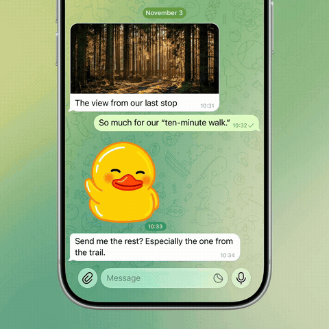

# showtime

Create app demo videos with your AI agent.

[Watch the full-quality video](assets/examples/attach-menu-duck.mp4).

## How to use

1. [Install showtime](docs/install.md).
2. Open your app project in your AI agent. For example, ask “Use `~/showtime/SKILL.md` to record how I save a note.”
3. Choose whether to show the whole phone or just the top or bottom of the screen.
4. Approve the scenario. The agent prepares, records, and checks your demo, then sends the finished MP4.

## How it works

showtime is a local toolkit that turns a scenario into a recorded app demo. Your AI agent prepares the scene, operates the app in iOS Simulator, and reviews the result. Python scripts record the screen, keep actions aligned with the footage, edit the take, and compose the finished video.

After you approve the scenario, preparation and quality checks happen inside the workflow. The first video you receive is the finished MP4, with the phone frame, background, and tap indicators already included.

### Agent instructions

[SKILL.md](SKILL.md) defines the workflow and defaults: one product benefit per video, realistic app content, character-by-character typing, complete native transitions, and a readable result. Supporting guides cover [scene preparation](docs/preparation.md), [recording and export](docs/showtime-execution.md), and [visual checks](docs/visual-acceptance.md).

The agent makes the editorial decisions: what to show, when the app has finished responding, which pauses can be shortened, and whether the final video looks right.

### Recording and editing scripts

| Component | What it does |
| --- | --- |
| [record_simulator.py](scripts/record_simulator.py) | Records the selected simulator and saves a clock file so actions can be aligned with that take. |
| [native_action.py](scripts/native_action.py) | Sends taps, holds, swipes, and text input through AXe. Logs action coordinates and timing in a journal tied to the recording. |
| [typing-driver.m](scripts/simulator/typing-driver.m) | An optional native helper for local simulator builds. Inserts text one composed character at a time into a focused text field, hides the caret while typing, and restores it afterward. |
| [scene_timeline.py](scripts/scene_timeline.py) and [edit_events.py](scripts/edit_events.py) | Build and apply cuts from the agent’s observations of the footage. Preserve declared transitions and reading time, keep app motion at its original speed, and remap tap timing to the edited video. |
| [gesture_timing.py](scripts/gesture_timing.py) | Aligns the ring animation with each contact. For a long press, holds the contact frame while preserving the animation’s entry and release. |
| [compose_pilot.py](scripts/compose_pilot.py) | Combines the recording, phone frame, background, and timed rings. Supports full-phone, top-crop, and bottom-crop layouts. Exports a 10–20 second, 1920 × 1920 MP4 at 60 fps. |

### Assets and profiles

- **Phone frames:** [assets/showtime/phones](assets/showtime/phones) contains schematic PNG frames in multiple sizes and colors. The [phone catalog](assets/showtime/phones.json) stores their dimensions and screen placement for matching the recording to the frame.
- **Backgrounds:** [gradients.json](assets/showtime/gradients.json) contains five palettes: Sage, Vivid, Graphite, Pastel, and Warm. The compositor generates the background from the selected palette.
- **Tap animation:** [assets/tap/native](assets/tap/native) contains 41 transparent PNG frames at 60 fps. The compositor can tint the ring, add background blur beneath it, and extend it for a hold. No After Effects project is needed to render the bundled animation.
- **Composition profile:** [telegram-product.json](profiles/telegram-product.json) supplies the starting settings for canvas size, framing, phone, background, and tap appearance. Each video gets its own saved profile so revisions use the same composition.

### Checks and saved work

[showtime_doctor.py](scripts/showtime_doctor.py) checks tools, dependencies, and assets before work begins. [verify_simulator_install.py](scripts/verify_simulator_install.py) checks that the installed app matches the intended local build.

[review_gate.py](scripts/review_gate.py) checks scenario approval and the internally reviewed scene materials. [check_preparation.py](scripts/check_preparation.py) checks preparation evidence and file hashes. [edit_review.py](scripts/edit_review.py) generates frame comparisons around cuts for inspection. [render_quality.py](scripts/render_quality.py) checks decoding, frame cadence, duration, and output dimensions.

The agent also watches the encoded video to check content, motion, visible taps, typing, framing, and the loop. Passing technical checks alone does not establish visual quality.

[showtime_run.py](scripts/showtime_run.py) keeps progress and artifact paths in `run.json`. Each video’s working directory retains the scenario, scene materials, source recording, action journal, observations, edit timeline, export, and verification reports. This lets the agent resume work and revise usable footage without starting over.

### Local toolchain

Recording uses macOS, Xcode’s iOS Simulator, and AXe for input. Editing and composition use Python with Pillow and NumPy, plus FFmpeg and ffprobe for video processing and inspection. See [installation](docs/install.md) for setup.
